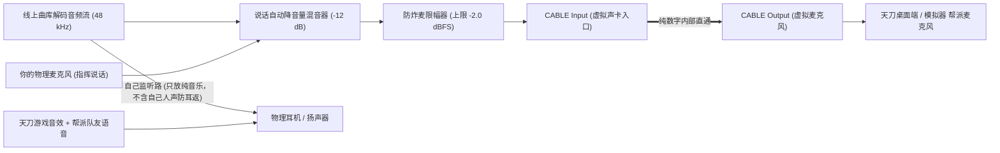

# 天涯明月刀 · 帮派语音自动点歌台

这是一个专门给国服 **《天涯明月刀》（官方桌面端 `qsgame.exe` / `wuxia.exe` 及安卓模拟器）** 帮派语音频道做的**全自动点歌放歌工具**。

### 这个工具能干嘛？
- **帮派打字就能点歌/切歌**：帮众在游戏左下角【帮派】频道发 `点歌：歌名-歌手` 或 `切歌：歌名-歌手`，后台会自动识图抓歌并推到帮派语音频道放给大家听（支持 2–3 行自动折行气泡拼接与繁简原唱优先匹配）。
- **周四、周日定时自动开播**：默认每周四、周日 `19:30–20:20`（帮派活动黄金时段）自动开播并识别点歌，平时自动静音待机（`0` 播放、`0` 识图扫描，不占电脑资源）；非活动时段想听也可随时一键点击「临时试播」或使用 `.\start.ps1 -LiveNow` 立即开播。
- **双路声音彻底隔离，不串麦不回声**：通过 VB-CABLE 虚拟声卡把音乐独立送进游戏麦克风，你自己耳机只听纯音乐，**绝不会把游戏技能声、背景音乐或队友说话录回去形成回声**。
- **指挥开麦自动压低音乐 + 防炸麦**：检测到你的物理麦克风开口说话时（阈值 `-38.0 dBFS`），自动把音乐平滑压低 `12.0 dB`；音乐高潮自动软限幅（峰值上限 `-2.0 dBFS`），队友听歌不破音。
- **听过的歌 24 小时不重复**：已播曲目会记录至 `played_history.json`，配合屏幕历史去重台账，确保老聊天气泡与听过的歌不再反复上播放列表。
- **只看屏幕不碰游戏内存**：全程通过 Windows 窗口画面抓取与本地图像文字识别读取帮派聊天，零内存注入、零临时图片落盘，安全合规。

---

## 一、三步快速上手

### 1. 首次运行前：音频与网络链路体检
在项目根目录打开 PowerShell，运行只读体检脚本（零发声、零弹窗）：

```powershell
.\scripts\audio_doctor.ps1
```

体检脚本会自动检查：
- Windows 音频输入/输出端点（是否已具备 `CABLE Input` 与 `CABLE Output`）
- 天刀官方桌面端（如 `<游戏安装目录>\WuxiaMobile\wuxia.exe` 或 `qsgame.exe`）或模拟器运行状态
- 本地代理 `127.0.0.1:10808` 与 `https://music.youtube.com` 连通性
- `.venv` 虚拟环境与 `sounddevice` `48000 Hz`（`48 kHz`）立体声采样率支持

### 2. 安装 VB-CABLE 官方虚拟声卡（首次必装）
若体检提示尚未安装虚拟声卡，请运行交互式安装向导：

```powershell
.\scripts\install_vbcable.ps1
```

- 按提示输入 `Y` 确认后，脚本将自动从 VB-Audio 官方源下载驱动包至 `data\vbcable_setup\`（主源 `Pack46` 失败时自动回退备用包 `Pack43`），解压并以管理员权限（UAC）打开 `VBCABLE_Setup_x64.exe`。
- 在弹出的安装窗口中点击 **`Install Driver`**，安装完成后**建议重启一次电脑**（或在管理员 PowerShell 中执行 `Restart-Service Audiosrv -Force` 重载音频服务）。

### 3. 一键启动与停止点歌控制台

首次部署请先将配置模板 `data\config.example.json` 复制一份为 `data\config.json`（或直接启动后在网页端保存生成）。

```powershell
# 按定时规则启动服务并打开控制台（周四/周日 19:30–20:20 自动开播，平时静音待机）
.\start.ps1

# 随时立即开播并激活 OCR 识别（已运行在待机态时可直接唤醒）
.\start.ps1 -LiveNow

# 仅后台启动，不自动弹出浏览器窗口
.\start.ps1 -NoBrowser

# 一键关闭后台服务并释放 8765 端口
.\scripts\stop.ps1
```

启动成功后：
- **本机控制台地址**：`http://127.0.0.1:8765`
- **局域网共享点歌地址**：`http://<本机局域网IP>:8765`（同一 Wi-Fi 下的手机或帮派管理可直接扫码/打开网页搜歌插播）

---

## 二、核心声学原理：为什么严禁使用“立体声混音”？

### 1. 为什么绝对不能用系统自带“立体声混音”？
许多传统教程会教玩家开启声卡的“立体声混音”来放歌，但在天刀帮派语音频道（尤其是帮战、联赛、修罗城等多人开麦场景）中存在致命缺陷：

1. **严重回声与串麦啸叫**：立体声混音会把你电脑上**所有正在播放的声音**原封不动录回麦克风。这意味着：**天刀游戏技能打击音效、游戏自带背景音乐，甚至帮派里队友和指挥说话的声音**，都会被你的麦克风再次录进去推回帮派语音，形成刺耳的回声死循环（串麦）。
2. **现代声卡普遍移除支持**：例如常见的 Realtek 声卡搭配 Intel 智音麦克风阵列（Smart Sound Technology）在硬件驱动层已不再提供立体声混音端点。

### 2. 虚拟声卡双路隔离与防炸麦信号链路
本系统通过 **VB-CABLE（纯数字虚拟声卡驱动）** 构建“游戏推流”与“自己耳机监听”两条完全隔离开的声音通道：



#### 关键声学与信号指标
| 环节 / 参数 | 默认设定值 | 作用说明 |
| :--- | :--- | :--- |
| **引擎采样率** | `48 kHz` (`48000 Hz`, 双声道) | 对齐系统与游戏语音采样率，避免重采样失真 |
| **防炸麦软限幅峰值** | `-2.0 dBFS` (线性幅值 `<= 0.7943`) | 平滑压住高潮爆音，防止触发游戏语音自动增益破音炸麦 |
| **人声闪避触发阈值** | `-38.0 dBFS` | 检测到指挥开口说话超过 `-38.0 dBFS` 时立即压低音乐 |
| **背景音乐闪避衰减量** | `-12.0 dB` (`-12 dB`) | 说话期间自动将背景音乐平滑压低 `12 dB`，指挥人声清晰不断歌 |
| **闪避动态包络时间** | `30 ms` 下潜 / `600 ms` 保持 / `500 ms` 恢复 | 说话切入迅速不吞首字，换气停顿 `600 ms` 内不忽大忽小 |
| **切歌预加载间隙** | `< 150 ms` | 提前将队列下一首缓存解码就绪，切歌无缝衔接 |

> **零延迟防卡壳设计**：本地监听路（输出到你的物理耳机）**只输出纯音乐，绝不混入你的物理麦克风人声**。这样你在说话时既不会听到 `20 ~ 60 ms` 软件延迟耳返导致自己说话打结，又能清晰听到帮派队友语音与柔和的背景歌单。

---

## 三、天刀桌面端与模拟器声音设置指南（必读）

### 第一步：检查 Windows 系统默认声卡（装完 VB-CABLE 后必查）
安装 VB-CABLE 驱动的瞬间，Windows 往往会自动把系统全局默认设备改成 `CABLE Input`。请按以下标准核对：
1. 点击任务栏右下角**小喇叭图标**（或打开 `系统 -> 声音`）：
   - **系统默认输出设备**：选回你的**物理耳机 / 扬声器**（如 `Realtek(R) Audio`）。
   - **系统默认输入设备**：选回你的**物理麦克风**（如 `英特尔® 智音技术麦克风阵列`）。
2. **切勿开启系统级“侦听此设备”**：请确保 Windows `声音控制面板 -> 录制 -> CABLE Output -> 属性 -> 侦听` 中**不要勾选**“侦听此设备”。如果你想自己也能听到点歌台播放的歌，直接在网页控制台【虚拟声卡与防串麦路由中心】打开**本地耳机监听**开关并独立调节监听音量（建议 `30% ~ 50%`）即可，避免双重叠加回响。
3. **推荐采样率对齐**：在 `声音控制面板` 中将 `CABLE Input`（播放）与 `CABLE Output`（录制）的高级默认格式统一设为 **`2 通道，24 位，48000 Hz (录音室音质)`**。

---

### 第二步（方案 A）：天涯明月刀官方桌面端 (`qsgame.exe` / `wuxia.exe`) 设置
针对本机安装的官方 PC 桌面端（如 `<游戏安装目录>\WuxiaMobile\wuxia.exe` 或《天涯明月刀·世界》`qsgame.exe`）：

1. **单独绑定天刀的麦克风为 `CABLE Output`**：
   - 先启动天涯明月刀桌面端并登录进入角色界面。
   - 按 `Win + I` 打开 Windows 设置 -> **系统 -> 声音 -> 音量合成器**（Windows 10 为“应用音量和设备首选项”，也可按 `Win + R` 输入 `ms-settings:apps-volume` 回车）。
   - 在应用列表中找到 **`天涯明月刀`**（`wuxia.exe`）展开：
     - **输出设备**：选择你的**物理耳机 / 扬声器**（正常听游戏音效与队友说话）。
     - **输入设备**：选择 **`CABLE Output (VB-Audio Virtual Cable)`**（将点歌台音频喂给天刀麦克风）。
2. **天刀游戏内声音与帮派麦设置**：
   - 打开游戏内【设置 -> 声音】：将你自己的“游戏背景音乐”调至 `0%`（防止自己耳机里两首歌叠音，同时丝毫不影响帮派队友听点歌台的歌）。
   - **关闭过度降噪（防吞歌声关键！）**：在游戏语音/麦克风相关设置及声卡控制台中，**关闭“强力 AI 降噪 / 环境音消除 / 回声抑制”**（如 Intel 智音控制台或 Realtek Audio Console 针对虚拟通道的效果器）。过度的人声降噪算法会把古筝、笛子、吉他前奏和尾音误判为“非人声背景噪音”直接切碎，导致队友听到歌声断断续续、忽大忽小。
   - **自由麦 vs 按键说话**：
     - 进入游戏主界面左下角【帮派语音频道】（或主播麦/管理麦位），切换为**常驻自由麦（开麦状态）**，即可实现 24 小时全自动放歌。
     - 若帮派开启了按键说话模式，需切换为自由开麦；若你同时需要自己开口指挥，只需在网页控制台开启【物理麦克风桥接 + 自动闪避】，无需频繁切换游戏麦克风设备！

---

### 第二步（方案 B）：安卓模拟器（MuMu / 雷电 / 逍遥 / 夜神 / BlueStacks）设置
如果你使用模拟器双开挂机当帮派专职点歌号：

1. **MuMu 模拟器 12**：
   - 点击模拟器右上角菜单 -> **设备设置 -> 音频（声音设置）**：
     - **扬声器 / 音频输出**：选择你的物理耳机（挂机号若无需听声音也可在模拟器音量栏把模拟器自身扬声器静音，不影响麦克风推流）。
     - **麦克风 / 音频输入**：选择 **`CABLE Output (VB-Audio Virtual Cable)`**。
     - **麦克风降噪 / 音频增强**：**务必关闭**！防止伴奏乐器与高频泛音被模拟器滤除。
2. **雷电模拟器 (LDPlayer) / 逍遥 / 夜神 / 蓝叠 / 腾讯手游助手**：
   - 打开模拟器右侧齿轮【软件设置 -> 音频设置】：
     - 将**麦克风**下拉框设为 **`CABLE Output (VB-Audio Virtual Cable)`**，保存后重启一次模拟器使底层音频句柄生效。
3. 进入游戏帮派频道点亮常驻麦克风图标即可持续放送。

---

## 四、帮派聊天框识图点歌设置与发歌格式

本工具采用**纯窗口外部图像文字识别**方案（优先使用系统后台抓窗配合内存截屏与本地文字识别），**绝不读取或修改游戏进程内存，截图全在内存中处理不落盘**，安全稳定。

### 1. 帮派聊天区框选与自动追踪
1. 把游戏聊天框切到 **【帮派】** 频道（保持游戏窗口未最小化；即使后台被网页或微信遮住也能照常识别）。
2. 在网页控制台 **【OCR识别】** 页开启 **自动追踪游戏窗口**，程序会自动定位帮派全高度聊天区域并避开左侧等级徽章与右侧头像；如游戏窗口布局自定义，也可用鼠标手动框选位置。
3. 默认仅在每周四、周日 `19:30–20:20` 开播时段自动提速至 `8 s` 扫描一次；平时定时待机下彻底休眠（`0` 次扫描）。

### 2. 帮众点歌与切歌怎么发？
默认启用严格指令模式，彻底防止大家聊天吹水误点歌：

- **点歌格式（`点歌：歌名-歌手`）**：
  - `点歌：晴天-周杰伦`
  - `点歌：失眠飞行-接个吻，开一枪`
  - `点歌：blackpink-DDU-DU DDU-DU`
- **切歌与插播格式（`切歌：歌名-歌手`）**：
  - 若正好是当前播放的歌，直接切到下一首；若是其他新歌，自动预缓存后置顶插播。

### 3. 防误触、多行换行拼接与 24 小时防重复
- **听过的歌不再上列表**：结合聊天气泡记忆台账与 24 小时已播曲目黑名单，滚屏置顶或重启软件都不会把老歌再排一遍。
- **两三行折行自动拼接**：歌名或歌手太长在游戏内换行折成 2~3 排时自动无缝拼回一整句。
- **日常游戏对话全过滤**：地图坐标（`123-456`）、比分、等级区间与常规闲聊句全部忽略。

---

## 五、线上曲库个人歌单（红心喜欢）与定时兜底歌单设置

### 1. 免登录即刻开播
即使不绑定账号，播音时段启动后也会自动加载内置免登录歌单（默认古风/天刀经典歌单）；点歌队列播空时由定时兜底电台自动续播。

### 2. 网络代理设置
若电脑直连线上曲库服务（`music.youtube.com`）较慢或需要代理：
1. 打开你的本地代理工具（例如常见 HTTP 端口 `127.0.0.1:10808`）。
2. 在网页控制台 **【曲库/电台】** 页的代理地址栏填入 `http://127.0.0.1:10808` 并保存（若本机已全局透明代理可直接留空）。

### 3. 绑定个人账号读取“我喜欢的音乐”与私人歌单
如果你想在定时时段轮播自己收藏的红心歌单或自建歌单，按下面两步操作：

#### 第一步：获取网页请求标头（读取私人歌单列表）
1. 在浏览器打开 `https://music.youtube.com` 并登录。
2. 按 **`F12`** 打开开发者工具，切到 **网络** 选项卡，在筛选框输入 `browse` 后刷新页面。
3. 点开任意一条状态码为 `200` 的 `browse` 请求，复制完整的 **请求标头**（或 `Cookie:` 行）。
4. 粘贴进控制台 **【曲库/电台】** 页面的文本框保存，再点「刷新歌单」即可一键设为帮派兜底歌单！

#### 第二步（选填）：导入 `cookies.txt`
若部分受限曲目需要登录态才能拉取音频流，可在浏览器导出账号 `cookies.txt` 粘贴到对应输入框保存（仅保存在本地 `data/cookies.txt`，严禁泄露给他人）。

---

## 六、零自动删文件安全机制与 `_待删除/` 缓存清理说明

为保障用户数据与系统绝对安全，本程序全栈严格执行 **“零文件自动清理”** 准则：

1. **本地音频高速缓存 (`data/cache/`)**：
   - 播放过或预加载过的歌曲会自动缓存在 `data/cache/` 目录中，二次点播秒开且免重复消耗流量。
   - 缓存池默认容量上限为 **`1024 MB`**（`1 GB`，可在配置中调整）。
- **如何处理旧文件？**
  - 所有被替换的旧配置备份与淘汰的旧音频缓存，都会自动附带时间戳归档移动至项目根目录下的：
    ```text
    <项目根目录>\_待删除\
    ```
3. **如何手动释放磁盘空间？**
   - 长期挂机运行数周后，你可以随时在 Windows 资源管理器中打开 `_待删除\` 文件夹，检查确认无需保留历史缓存后，由你本人手动选中移入系统回收站清理即可。

---

## 七、常见问题排查

- **问：帮派队友反映听到的歌声断断续续，前奏纯乐器声没了，一到唱歌又有声音？**
  - **答**：100% 是游戏内、模拟器或声卡驱动开启了 **“AI 语音降噪 / 麦克风环境音抑制”**，降噪会把纯乐器伴奏当噪音切掉。请按上文第三节关闭降噪。
- **问：我自己耳机里听不到点歌台的歌，但控制台电平条在正常跳动？**
  - **答**：说明声音已经正常推进了虚拟声卡（队友能听到）。如果你想自己也听到，请在网页控制台【声卡路由】页面打开 **“本地耳机监听”** 并选择你的物理耳机。
- **问：队友听到明显破音或忽大忽小？**
  - **答**：建议控制台推流音量保持在 `80% ~ 100%`（程序内置 `-2.0 dBFS` 防炸麦限幅保护），游戏内麦克风采集音量调在 `70% ~ 85%`。
