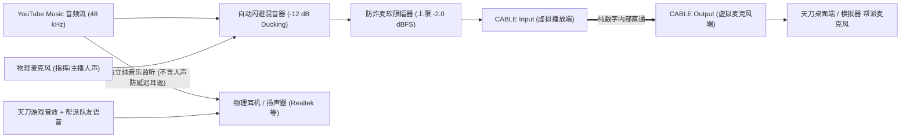

# 天刀·帮派定时语音点歌台 (`wuxia-ytm-radio`)

专为 **《天涯明月刀》桌面端（`qsgame.exe` / `wuxia.exe`）及主流安卓模拟器** 打造的帮派语音频道 **YouTube Music 定时点歌电台**（默认每周四、周日 `19:30–20:20` 自动开播与识别，平时彻底静音待机 `0` 播放 / `0` OCR 扫描，亦支持随时一键临时开播）。

核心特性：
- **双路音频物理隔离防串麦**：YouTube Music + 物理麦混音推流至虚拟声卡，本地耳机仅听纯音乐（无延迟耳返，不回录队友语音）。
- **广播级音频保护**：`48 kHz` 立体声引擎、`-2.0 dBFS` 防炸麦软限幅、`-38.0 dBFS` 触发 / `-12.0 dB` 指挥人声自动闪避。
- **每周四/周日 `19:30–20:20` 定时播控**：非播音时段自动停播并休眠 OCR 扫描（`0` 网络拉歌、`0` 截图消耗），到点自动开播，结束自动静音并清空遗留队列；随时点击「临时试播」或使用 `.\start.ps1 -LiveNow` 可立即唤醒。
- **防遮挡视觉点歌 (OCR)**：基于 DWM `PrintWindow` 后台无遮挡抓窗 + RapidOCR 内存推理（零临时图片落盘），支持 2–3 行气泡折行拼接、严格 `点歌：歌名-歌手` / `切歌：歌名-歌手` 指令、24 小时上下文去重台账，以及 **24 小时已播曲目黑名单（`played_history.json`）** 确保听过的歌不再自动重排。
- **繁简原唱优先选歌**：内置繁简归一化与双语副标题识别，精确匹配原唱音轨、压制翻唱/DJ 混音误选。

---

## 一、三步快速上手

### 1. 首次运行前：音频与网络链路体检
在项目根目录打开 PowerShell，运行只读体检脚本（零发声、零弹窗）：

```powershell
.\scripts\audio_doctor.ps1
```

体检脚本会自动检查：
- Windows 音频输入/输出端点（是否已具备 `CABLE Input` 与 `CABLE Output`）
- 天刀官方桌面端（如 `<游戏安装目录>\WuxiaMobile\wuxia.exe` 或 `qsgame.exe`）或模拟器运行状态
- 本地代理 `127.0.0.1:10808` 与 `https://music.youtube.com` 连通性
- `.venv` 虚拟环境与 `sounddevice` `48000 Hz`（`48 kHz`）立体声采样率支持

### 2. 安装 VB-CABLE 官方虚拟声卡（首次必装）
若体检提示尚未安装虚拟声卡，请运行交互式安装向导：

```powershell
.\scripts\install_vbcable.ps1
```

- 按提示输入 `Y` 确认后，脚本将自动从 VB-Audio 官方源下载驱动包至 `data\vbcable_setup\`（主源 `Pack46` 失败时自动回退备用包 `Pack43`），解压并以管理员权限（UAC）打开 `VBCABLE_Setup_x64.exe`。
- 在弹出的安装窗口中点击 **`Install Driver`**，安装完成后**建议重启一次电脑**（或在管理员 PowerShell 中执行 `Restart-Service Audiosrv -Force` 重载音频服务）。

### 3. 一键启动与停止点歌控制台

首次部署请先将配置模板 `data\config.example.json` 复制一份为 `data\config.json`（或直接启动后在网页端保存生成）。

```powershell
# 按定时规则启动服务并打开控制台（周四/周日 19:30–20:20 自动开播，平时静音待机）
.\start.ps1

# 随时立即开播并激活 OCR 识别（已运行在待机态时可直接唤醒）
.\start.ps1 -LiveNow

# 仅后台启动，不自动弹出浏览器窗口
.\start.ps1 -NoBrowser

# 一键关闭后台服务并释放 8765 端口
.\scripts\stop.ps1
```

启动成功后：
- **本机控制台地址**：`http://127.0.0.1:8765`
- **局域网共享点歌地址**：`http://<本机局域网IP>:8765`（同一 Wi-Fi 下的手机或帮派管理可直接扫码/打开网页搜歌插播）

---

## 二、核心声学原理：为什么严禁使用“立体声混音”？

### 1. 为什么绝对不能用“立体声混音 (Stereo Mix)”？
许多传统教程会教玩家开启声卡的“立体声混音”来放歌，但在天刀帮派语音频道（尤其是帮战、联赛、修罗城等多人开麦场景）中存在致命缺陷：

1. **严重回声与串麦啸叫**：立体声混音会把你电脑上**所有正在播放的声音**原封不动录回麦克风。这意味着：**天刀游戏技能打击音效、游戏自带背景音乐，甚至帮派里队友和指挥说话的声音**，都会被你的麦克风再次录进去推回帮派语音，形成刺耳的回声死循环（串麦）。
2. **现代声卡普遍移除支持**：例如常见的 Realtek 声卡搭配 Intel 智音麦克风阵列（Smart Sound Technology）在硬件驱动层已不再提供立体声混音端点。

### 2. VB-CABLE 双路隔离与防炸麦 DSP 架构
本系统通过 **VB-CABLE 纯数字虚拟声卡** 构建“推流总线”与“本地监听总线”双路完全隔离的广播级信号链：



#### 关键声学与信号指标（带物理单位）
| 环节 / 参数 | 默认设定值 | 工程作用说明 |
| :--- | :--- | :--- |
| **引擎采样率** | `48 kHz` (`48000 Hz`, 双声道) | 对齐 Windows WASAPI 与游戏语音引擎标准采样率，避免重采样音质劣化 |
| **防炸麦软限幅峰值** | `-2.0 dBFS` (线性幅值 `<= 0.7943`) | 平滑抑制高潮爆音，防止触发游戏 GVoice 自动增益控制（AGC）破音炸麦 |
| **人声闪避触发阈值** | `-38.0 dBFS` | 当物理麦克风检测到主播/指挥开口说话超过 `-38.0 dBFS` 时立即触发闪避 |
| **背景音乐闪避衰减量** | `-12.0 dB` (`-12 dB`) | 说话期间自动将背景音乐平滑压低 `12 dB`，人声清晰突出、音乐不断流 |
| **闪避动态包络时间** | `30 ms` 下潜 / `600 ms` 保持 / `500 ms` 恢复 | 说话切入迅速不吞首字，换气停顿 `600 ms` 内不频繁忽大忽小，恢复自然 |
| **切歌预加载间隙** | `< 150 ms` | 24h Auto-DJ 提前将下一首缓存解码就绪，切歌无缝衔接 |

> **零延迟防卡壳设计**：本地监听路（输出到你的物理耳机）**只输出纯音乐，绝不混入你的物理麦克风人声**。这样你在说话时既不会听到 `20 ~ 60 ms` 软件延迟耳返导致自己说话打结，又能清晰听到帮派队友语音与柔和的背景歌单。

---

## 三、天刀桌面端与模拟器声音设置指南（必读）

### 第一步：检查 Windows 系统默认声卡（装完 VB-CABLE 后必查）
安装 VB-CABLE 驱动的瞬间，Windows 往往会自动把系统全局默认设备改成 `CABLE Input`。请按以下标准核对：
1. 点击任务栏右下角**小喇叭图标**（或打开 `系统 -> 声音`）：
   - **系统默认输出设备**：选回你的**物理耳机 / 扬声器**（如 `Realtek(R) Audio`）。
   - **系统默认输入设备**：选回你的**物理麦克风**（如 `英特尔® 智音技术麦克风阵列`）。
2. **切勿开启系统级“侦听此设备”**：请确保 Windows `声音控制面板 -> 录制 -> CABLE Output -> 属性 -> 侦听` 中**不要勾选**“侦听此设备”。如果你想自己也能听到点歌台播放的歌，直接在网页控制台【虚拟声卡与防串麦路由中心】打开**本地耳机监听**开关并独立调节监听音量（建议 `30% ~ 50%`）即可，避免双重叠加回响。
3. **推荐采样率对齐**：在 `声音控制面板` 中将 `CABLE Input`（播放）与 `CABLE Output`（录制）的高级默认格式统一设为 **`2 通道，24 位，48000 Hz (录音室音质)`**。

---

### 第二步（方案 A）：天涯明月刀官方桌面端 (`qsgame.exe` / `wuxia.exe`) 设置
针对本机安装的官方 PC 桌面端（如 `<游戏安装目录>\WuxiaMobile\wuxia.exe` 或《天涯明月刀·世界》`qsgame.exe`）：

1. **单独绑定天刀的麦克风为 `CABLE Output`**：
   - 先启动天涯明月刀桌面端并登录进入角色界面。
   - 按 `Win + I` 打开 Windows 设置 -> **系统 -> 声音 -> 音量合成器**（Windows 10 为“应用音量和设备首选项”，也可按 `Win + R` 输入 `ms-settings:apps-volume` 回车）。
   - 在应用列表中找到 **`天涯明月刀`**（`wuxia.exe`）展开：
     - **输出设备**：选择你的**物理耳机 / 扬声器**（正常听游戏音效与队友说话）。
     - **输入设备**：选择 **`CABLE Output (VB-Audio Virtual Cable)`**（将点歌台音频喂给天刀麦克风）。
2. **天刀游戏内声音与帮派麦设置**：
   - 打开游戏内【设置 -> 声音】：将你自己的“游戏背景音乐”调至 `0%`（防止自己耳机里两首歌叠音，同时丝毫不影响帮派队友听点歌台的歌）。
   - **关闭过度降噪（防吞歌声关键！）**：在游戏语音/麦克风相关设置及声卡控制台中，**关闭“强力 AI 降噪 / 环境音消除 / 回声抑制”**（如 Intel 智音控制台或 Realtek Audio Console 针对虚拟通道的效果器）。过度的人声降噪算法会把古筝、笛子、吉他前奏和尾音误判为“非人声背景噪音”直接切碎，导致队友听到歌声断断续续、忽大忽小。
   - **自由麦 vs 按键说话**：
     - 进入游戏主界面左下角【帮派语音频道】（或主播麦/管理麦位），切换为**常驻自由麦（开麦状态）**，即可实现 24 小时全自动放歌。
     - 若帮派开启了按键说话模式，需切换为自由开麦；若你同时需要自己开口指挥，只需在网页控制台开启【物理麦克风桥接 + 自动闪避】，无需频繁切换游戏麦克风设备！

---

### 第二步（方案 B）：安卓模拟器（MuMu / 雷电 / 逍遥 / 夜神 / BlueStacks）设置
如果你使用模拟器双开挂机当帮派专职点歌号：

1. **MuMu 模拟器 12**：
   - 点击模拟器右上角菜单 -> **设备设置 -> 音频（声音设置）**：
     - **扬声器 / 音频输出**：选择你的物理耳机（挂机号若无需听声音也可在模拟器音量栏把模拟器自身扬声器静音，不影响麦克风推流）。
     - **麦克风 / 音频输入**：选择 **`CABLE Output (VB-Audio Virtual Cable)`**。
     - **麦克风降噪 / 音频增强**：**务必关闭**！防止伴奏乐器与高频泛音被模拟器滤除。
2. **雷电模拟器 (LDPlayer) / 逍遥 / 夜神 / 蓝叠 / 腾讯手游助手**：
   - 打开模拟器右侧齿轮【软件设置 -> 音频设置】：
     - 将**麦克风**下拉框设为 **`CABLE Output (VB-Audio Virtual Cable)`**，保存后重启一次模拟器使底层音频句柄生效。
3. 进入游戏帮派频道点亮常驻麦克风图标即可持续放送。

---

## 四、帮派聊天框视觉点歌（OCR）配置与点歌格式

本系统采用**纯进程外 DWM / 内存视觉识别**方案（`PrintWindow` 防遮挡抓窗 / `mss` 内存截屏 + `RapidOCR` 内存推理），**绝不读取或注入游戏进程内存，且截图 100% 在内存中处理、零临时图片落盘**，安全稳定。

### 1. 框选帮派聊天区域步骤
1. 将天刀游戏左侧聊天框切换到 **【帮派】** 频道（勿最小化游戏窗口；后台被其他窗口遮挡时仍可通过 `PrintWindow` 正常读取）。
2. 打开网页控制台 **【OCR识别】** 标签页：
   - 开启 **自动追踪游戏窗口** 后会自动锁定帮派全高度聊天区并过滤左侧等级徽章与右侧头像；也可手动拖拽框选自定义 ROI；
   - 默认非高峰期可按 `30 s` 扫描，每周四、周日 `19:30–20:20` 活动时段自动提速至 `8 s`（配合定时播控，在非播音时段自动休眠 `0` 扫描）。
   - 可随时点击 **“用模拟图一键自检”** 测试识别管线。

### 2. 帮派成员点歌与切歌格式
推荐使用默认严格模式 **`prefix`**（彻底防止闲聊误点歌），亦可在控制台切换为 `both` 双模兼容：

- **点歌指令（必须带冒号与 `-` 分隔）**：
  - `点歌：晴天-周杰伦`
  - `点歌：失眠飞行-接个吻，开一枪`
  - `点歌：blackpink-DDU-DU DDU-DU`
- **切歌与插播指令**：
  - `切歌：歌名-歌手`（若正好是当前播放曲目则直接切到下一首；若为新歌则预加载并置顶插播；`both` 模式下亦支持单独发送 `切歌` / `下一首`）

### 3. 防误触、折行拼接与 24h 防重复入队机制
- **多层去重与 24h 已播黑名单**：结合屏幕静止去重、`ocr_seen.json` 上下文记忆（含滚动至顶行保护）以及 `played_history.json` **24 小时已播曲目黑名单**（按 `video_id` 与繁简归一化歌名双键记录），保证听过的歌与历史聊天气泡不会重复挤进列表。
- **自动折行拼接**：聊天文本超出 1 排自动换行（`2–3` 行）时按 Y 轴行距自动无缝拼接，英文换行断词亦可完整还原。
- **严格过滤游戏日常黑话与数字**：自动忽略地图坐标（如 `123-456`）、比分（`3-2`）、等级与帧率区间（`80-90级`、`60-120帧`）、硬件型号与编码（`RTX-4060`、`UTF-8`、`Wi-Fi`）以及超长闲聊句。

---

## 五、YouTube Music 个人歌单 Cookie 绑定与 24h 电台配置

### 1. 免登录即刻开播
即使不绑定任何账号，系统启动后也会自动加载免登录兜底曲库（默认内置 `"search:天涯明月刀 古风 经典"`、华语经典流行、纯音乐古筝笛子等电台种子），队列播空时由 **24h Auto-DJ** 自动无缝续播。

### 2. 网络代理设置
若你所在网络无法直连 `music.youtube.com`：
1. 启动你的本地代理客户端（例如常见默认 HTTP 端口 `127.0.0.1:10808`）。
2. 在控制台 **【YouTube Music 个人曲库】** 页的代理地址栏填入：`http://127.0.0.1:10808` 并点击保存。

### 3. 绑定个人账号读取“我喜欢的音乐 (LM)”与私人歌单
如果你想让帮派 24 小时循环播放你自己在 YouTube Music 点赞收藏的红心歌单（`Liked Music`）或自建歌单，请按以下步骤绑定：

#### 第一部分：获取网页请求标头（用于读取私人歌单列表）
1. 使用 Chrome 或 Edge 浏览器打开 `https://music.youtube.com` 并登录你的账号。
2. 按键盘 **`F12`** 打开开发者工具，切换到顶部的 **`Network`（网络）** 选项卡。
3. 在筛选框中输入 `browse`，然后点击网页左侧的 **“媒体库 (Library)”** 或刷新页面。
4. 在下方请求列表中点击任意一条状态码为 `200` 的 `browse?...` 请求，在右侧 **`Headers`（标头）** 面板找到 **`Request Headers`（请求标头）**：
   - 右键复制完整的请求标头文本（或直接复制其中的 `Cookie:` 整行内容）。
5. 回到本点歌台网页 **【YouTube Music 个人曲库】** 页，粘贴至 **“请求头 / Cookie”** 输入框并提交保存。
6. 保存成功后点击刷新歌单下拉框，即可看到 **`我喜欢的音乐 (Liked Music)`** 及你创建的全部私人歌单，一键设为 **24h 无人值守兜底歌单**！

#### 第二部分（可选）：配置 `cookies.txt`（用于高音质受限曲目流提取）
若遇到少数需要登录态或年龄确认才能拉取音频流的单曲：
1. 在浏览器安装常用的 `Get cookies.txt LOCALLY` 扩展，在 `music.youtube.com` 页面导出 Netscape 格式的 `cookies.txt` 文本。
2. 将文本内容粘贴至控制台的 **`cookies.txt` 内容框**点击保存，系统会自动存储至 `data/cookies.txt` 供音频提取引擎调用。

---

## 六、零自动删文件安全机制与 `_待删除/` 缓存清理说明

为保障用户数据与系统绝对安全，本程序全栈严格执行 **“零文件自动清理”** 准则：

1. **本地音频高速缓存 (`data/cache/`)**：
   - 播放过或预加载过的歌曲会自动缓存在 `data/cache/` 目录中，二次点播秒开且免重复消耗流量。
   - 缓存池默认容量上限为 **`1024 MB`**（`1 GB`，可在配置中调整）。
- **如何处理旧文件？**
  - 所有被替换的旧配置备份与淘汰的旧音频缓存，都会自动附带时间戳归档移动至项目根目录下的：
    ```text
    <项目根目录>\_待删除\
    ```
3. **如何手动释放磁盘空间？**
   - 长期挂机运行数周后，你可以随时在 Windows 资源管理器中打开 `_待删除\` 文件夹，检查确认无需保留历史缓存后，由你本人手动选中移入系统回收站清理即可。

---

## 七、常见问题排查（FAQ）

- **Q：帮派队友反映听到的歌声断断续续，前奏纯乐器声没了，一到唱歌又有声音？**
  - **A**：100% 是游戏内或模拟器/声卡驱动开启了 **“AI 语音降噪 / 麦克风环境音抑制”**。降噪算法专门保留人声频段而把乐器伴奏当噪音抹掉了。请按上文第三节关闭模拟器与声卡的麦克风降噪功能。
- **Q：我自己耳机里听不到点歌台的歌，但控制台电平条在正常跳动？**
  - **A**：说明声音已经正确推送进了虚拟声卡 `CABLE Input`（帮派队友能听到）。如果你想自己也听到，请在网页控制台【虚拟声卡与防串麦路由中心】开启 **“本地耳机监听”** 并选择你的物理耳机即可。
- **Q：队友听到明显破音或忽大忽小？**
  - **A**：请保持控制台推流音量在 `80% ~ 100%`（内置 `-2.0 dBFS` 防炸麦软限幅会自动保护），并将游戏内麦克风采集音量调至 `70% ~ 85%` 左右，避免游戏客户端二次数字放大过载。
